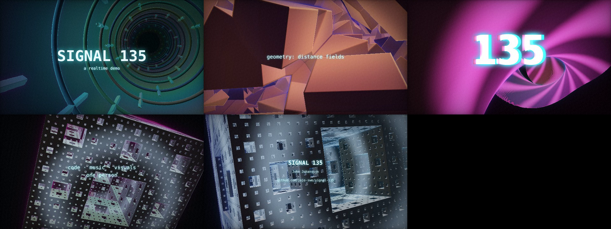

# SIGNAL 135

A 3-minute realtime demo. One HTML page, one synth file, zero libraries.

Every pixel is raymarched from signed distance fields in a single fragment shader. Every audio sample comes from `synth.js`, a pure function of time: no samples, no buffers, no state. The same function drives the browser playback and the offline video render, so picture and sound cannot drift.



## Run it

Open `index.html` in a browser with WebGL2 and click **PLAY** (sound on). Or serve the folder:

```
npx serve .
```

## How it works

| Part | What it does |
|---|---|
| `index.html` | WebGL2 fullscreen triangle, one fragment shader with four scenes (tunnel, KIFS fractal, gyroid, Menger sponge), 2D canvas text overlay, adaptive resolution |
| `synth.js` | 128 BPM, Am–F–C–G with an F–G–Em–Am B-section. Kick, hats, clap, additive bass, detuned pad, 16th arp with stateless echo (the delay is just `arp(t - d)`), vibrato lead |
| `render.js` | Headless Chromium renders each frame at an exact timestamp, Node writes the WAV from the same synth, ffmpeg muxes to MP4 |

Render the video yourself:

```
npm i playwright && npx playwright install chromium
node render.js 1920 1080 60
```

## Timeline

| Time | Scene | Music |
|---|---|---|
| 0–30 s | Neon tunnel | Pad, hats, kick enters at 7.5 s, bass at 22.5 s |
| 30–60 s | Folding fractal | Arp enters |
| 60–90 s | Gyroid | Drop (clap, lead), breakdown at 75 s |
| 90–120 s | Menger sponge | B-section chords, build, drop at 105 s |
| 120–165 s | Reprise: tunnel, fractal, gyroid in new colours | Full energy |
| 165–180 s | Menger sponge | Outro, credits |

Check the synth with `npm test`.

## License

© John Johansson. All rights reserved.
